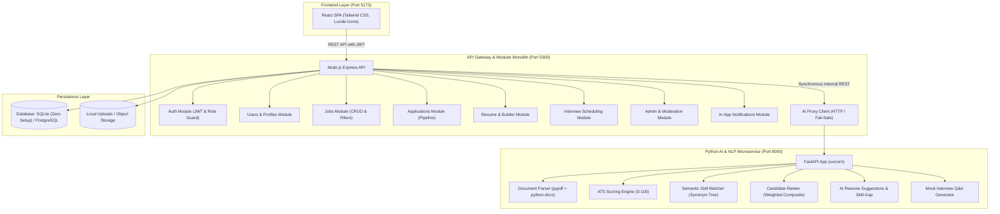

# Smart Recruitment & Hiring Platform — AI-Augmented ATS & Matching Platform

[](https://nodejs.org/)
[](https://fastapi.tiangolo.com/)
[](https://react.dev/)
[](https://tailwindcss.com/)
[](LICENSE)

> **B.Tech Final Year Capstone Project**  
> A full-stack, enterprise-grade AI recruitment platform combining a **React SPA**, a **Modular Monolith Node.js Backend**, and an internal **Python FastAPI AI Microservice** for OCR resume parsing, ATS compatibility evaluation, semantic skill matching, composite candidate ranking, and mock interview generation.

---

## 1. System Architecture

The project implements a **Modular Monolith** architecture designed with clear service boundaries to enable zero-friction scaling into microservices.



---

## 2. Key Features

### 👤 Candidate Experience
- **1-Click Demo Evaluation:** Instant login as Alex Chen (Senior Full Stack) or Sarah Miller (AI Engineer).
- **Interactive Job Search:** Real-time filter by role, location, and technical competencies.
- **AI Skill-Gap Preview:** Before applying, view semantic profile match %, matched skills, and curated learning roadmaps for missing requirements.
- **AI Resume Builder:** Structured step-by-step form with live ATS-formatted preview, action-verb guidance, and PDF export.
- **Resume OCR Parser:** Upload standard `.pdf` or `.docx` resumes with automatic entity extraction.
- **AI Mock Interview Simulator:** Practice role-specific architectural, behavioral, and troubleshooting questions with model answers and evaluation rubrics.
- **Application Tracking:** Real-time pipeline tracking (`applied` → `under_review` → `shortlisted` → `interview_scheduled` → `hired`).

### 🏢 Recruiter Experience
- **Job Creation & Pipeline:** Post positions with detailed required skills, experience levels, and employment types.
- **AI Candidate Ranking:** Applications are automatically scored and ranked using a composite score:
  $$\text{Composite Score} = 40\% \times \text{ATS Score} + 60\% \times \text{Skill Match Score}$$
- **Applicant Dossier:** Inspect candidate profile, matched skills, ATS formatting flags, and resume snapshots.
- **Interview Scheduling:** Propose multiple date/time slots, set video meeting links, and track candidate confirmations.
- **One-Click Hiring Decisions:** Transition statuses directly with automatic candidate notifications.

### 🛡️ Admin Experience
- **Platform Analytics:** Real-time metrics on total candidates, recruiters, jobs, applications, and average ATS scores.
- **User Management:** Suspend or activate user accounts, view profile activity.
- **Job Moderation:** Review and flag/close job postings.
- **Audit Logs Trail:** Tamper-evident trail tracking administrative actions.

---

## 3. Pre-Seeded Demo Accounts

For grading, evaluations, and viva demonstrations, the database comes pre-seeded with realistic data:

| Role | Email | Password | Description |
|---|---|---|---|
| **Admin** | `admin@recruitment.com` | `Password123!` | System Administrator with full analytics |
| **Recruiter** | `recruiter@google.com` | `Password123!` | Google Cloud recruiter with active postings & applicants |
| **Recruiter** | `hiring@microsoft.com` | `Password123!` | Microsoft recruiter with frontend engineering roles |
| **Candidate** | `alex.chen@gmail.com` | `Password123!` | Senior Full Stack Engineer (94% ATS readiness) |
| **Candidate** | `sarah.miller@gmail.com` | `Password123!` | AI / ML Systems Engineer with confirmed interview |
| **Candidate** | `rohit.sharma@gmail.com` | `Password123!` | Junior Frontend Developer |

> **Tip:** You can also use the **"Switch Demo Role"** dropdown on the top navbar to switch between personas with a single click without logging in and out!

---

## 4. Quickstart (Running the Project)

### Option A: 1-Click Launch (Windows)

Double click `run-all.bat` or run:
```powershell
.\run-all.ps1
```
This opens 3 terminals running the Backend (Port 5000), AI Service (Port 8000), and Frontend (Port 5173).

---

### Option B: Manual Step-by-Step

#### 1. Start Python AI Microservice (Port 8000)
```bash
cd ai-service
pip install -r requirements.txt
python -m uvicorn app.main:app --reload --port 8000
```

#### 2. Start Node.js Backend API (Port 5000)
```bash
cd backend
npm install
npm run seed     # (Initializes and seeds database)
npm run dev
```

#### 3. Start React Frontend (Port 5173)
```bash
cd frontend
npm install
npm run dev
```

Open your browser at: **`http://localhost:5173`**

---

### Option C: Docker Compose

```bash
docker-compose up --build
```
This launches PostgreSQL, Redis, Node Backend, Python AI Service, and React Frontend in Docker containers.

---

## 5. API Endpoints Reference

### Auth & Users
- `POST /api/auth/register` — Register candidate or recruiter
- `POST /api/auth/login` — Login and receive JWT
- `GET /api/auth/me` — Current user and role profile
- `GET /api/users/candidates/:id` — Candidate profile
- `PUT /api/users/candidates/:id` — Update candidate profile
- `GET /api/users/recruiters/:id` — Recruiter profile

### Jobs
- `GET /api/jobs` — Search & filter positions (public)
- `GET /api/jobs/:id` — Job details with company metadata
- `POST /api/jobs` — Create position (Recruiter only)
- `PUT /api/jobs/:id` — Update position
- `DELETE /api/jobs/:id` — Close/delete position
- `GET /api/jobs/recruiter/:recruiterId` — Recruiter's postings

### Applications & Scoring
- `POST /api/applications` — Candidate applies (triggers AI scoring & auto-ranks)
- `GET /api/applications/job/:jobId` — Ranked applicants for job
- `GET /api/applications/candidate/:candidateId` — Candidate's applications
- `PUT /api/applications/:id/status` — Update hiring status

### Resumes & AI
- `POST /api/resumes/upload` — Upload PDF/DOCX (OCR + parsing)
- `POST /api/resumes/build` — Structured resume builder save
- `GET /api/resumes/:candidateId/suggestions?jobId=` — AI resume advice
- `GET /api/resumes/:candidateId/skill-gap?jobId=` — AI skill-gap analysis
- `POST /api/ai/mock-interview-questions` — Generate mock interview Q&A

### Interviews & Admin
- `POST /api/interviews` — Propose interview slots
- `PUT /api/interviews/:id/confirm` — Confirm selected slot
- `GET /api/admin/analytics/summary` — High-level platform KPIs
- `GET /api/admin/users` — User management
- `PUT /api/admin/users/:id/suspend` — Suspend / activate account
- `GET /api/notifications` — In-app notification center

---

## 6. Academic Viva & Defense Q&A

### Q1: Why use a Modular Monolith instead of full Microservices?
> **Answer:** In early-stage startups and MVPs, distributed microservices introduce unnecessary operational complexity (network latency, distributed transactions, partial failures, split databases). By using a **Modular Monolith** inside Node.js, we maintain strict logical boundaries between modules (`auth`, `jobs`, `applications`, `interviews`) through clean interfaces. The only separate service is the **Python AI microservice**, split deliberately because AI/ML workloads (OCR, NLP, token embeddings) are CPU/GPU-intensive and benefit from Python's machine learning ecosystem.

### Q2: How does the AI ATS Scoring Engine calculate compatibility?
> **Answer:** The engine uses a multi-factor rubric:
> 1. **Contact Completeness (10 pts):** Verified email, phone, and standard headers.
> 2. **Professional Headline (10 pts):** Targeted domain alignment.
> 3. **Quantifiable Experience (20 pts):** Action-verb detection and metric presence (numbers, percentages, scale indicators).
> 4. **Education Formatting (10 pts):** Accredited degree identification.
> 5. **Skill Breadth (10 pts):** Density of identified technical competencies.
> 6. **Keyword Alignment (10-40 pts):** Semantic overlap against the target job's required skills.

### Q3: How does the semantic skill matching handle variants like "React.js" and "React"?
> **Answer:** A canonical synonym tree and token normalizer maps acronyms and framework aliases (e.g. `React.js` $\leftrightarrow$ `React`, `K8s` $\leftrightarrow$ `Kubernetes`, `ML` $\leftrightarrow$ `Machine Learning`, `TS` $\leftrightarrow$ `TypeScript`, `Postgres` $\leftrightarrow$ `PostgreSQL`).

### Q4: How is candidate ranking determined?
> **Answer:** Candidates are ordered by a configurable composite formula:
> $$\text{Rank Score} = 0.40 \times \text{ATS Score} + 0.60 \times \text{Skill Match Score}$$
> This guarantees that high formatting alone doesn't place an unqualified applicant at the top, and qualified candidates with slight formatting deficiencies still surface strongly.

---

## 7. License
Developed for Academic Capstone Demonstration. MIT License.
